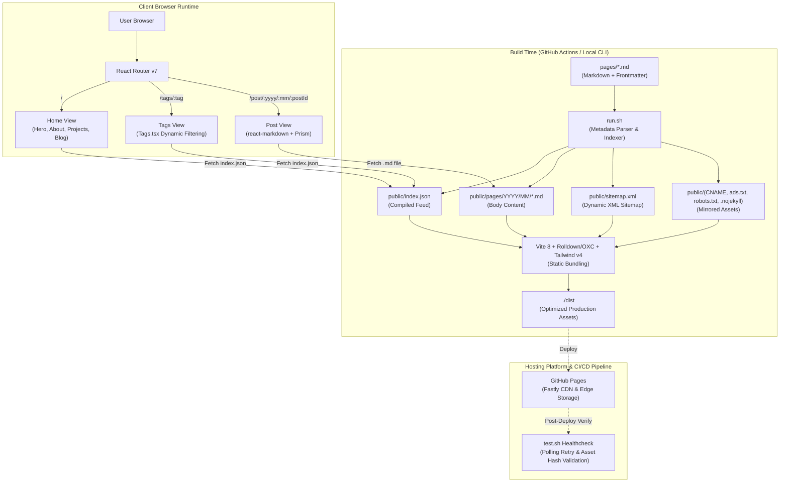

# System Architecture

Arsitektur sistem, alur pemrosesan data, model eksekusi runtime, dan pipeline pengiriman untuk situs web portofolio & blog teknis **KAnggara75.github.io**.

---

## 1. Component Architecture & Diagram

Sistem beroperasi sebagai Single Page Application (SPA) modern berbasis React 19 dan Vite 8 (Rolldown/OXC), yang di-host secara serverless pada infrastruktur GitHub Pages dengan domain kustom `kanggara.my.id`.



---

## 2. Request & Data Lifecycle

### 2.1 Alur Pre-Build (Penyusunan Metadata Artikel & Sitemap)

1. Developer menambahkan atau memperbarui dokumen artikel di direktori `pages/*.md`.
2. Skrip `run.sh` membaca header frontmatter YAML (`title`, `subtitle`, `author`, `tags`, `source`).
3. Baris frontmatter dipisahkan dari isi artikel, lalu artikel dipindahkan ke direktori `public/pages/YYYY/MM/DD-name`.
4. Berkas metadata agregat dihasilkan pada `public/index.json` dengan path gambar absolut (`/img/...`) untuk konsumsi feed klien.
5. Fungsi `generate_sitemap()` menyusun `public/sitemap.xml` yang memetakan rute utama (`/`, `/about`, `/tags`), seluruh kategori tag dinamis, serta seluruh artikel Markdown dengan atribut `<lastmod>`.
6. Fungsi `sync_static_assets()` menyinkronkan berkas `CNAME`, `ads.txt`, `robots.txt`, dan `.nojekyll` ke dalam direktori `public/` agar terbawa otomatis oleh Vite ke `dist/`.

### 2.2 Alur Runtime Klien (Client-Side Rendering)

1. **Initial Load**: Pengunjung mengakses `https://kanggara.my.id`. GitHub Pages menyajikan `index.html` dan bundel JavaScript/CSS hasil optimasi Vite.
2. **Beranda (`Home.tsx`)**:
   - Komponen `Blog.tsx` mengeksekusi `fetch('/index.json')`.
   - Data feed di-parse ke tipe antarmuka `PostsList`.
   - Enam tulisan terbaru diekstrak dan dirender menggunakan komponen `PostThumb`.
3. **Kurasi Tag (`Tags.tsx`)**:
   - Parameter tag diambil via `useParams()` dari React Router (`/tags/:tag`).
   - Melakukan `fetch('/index.json')` dan memfilter artikel secara case-insensitive (`post.tags.some(...)`).
   - Menyajikan badge selector topik interaktif dengan penghitung jumlah artikel per tag dan Empty State bila tidak ditemukan.
4. **Pembaca Artikel (`Post.tsx`)**:
   - Parameter URL diekstrak via hook `useParams()` dari React Router (`yyyy`, `mm`, `postId`).
   - Browser melakukan dua panggilan HTTP `fetch` paralel:
     - Mengambil konten teks mentah Markdown dari `/pages/YYYY/MM/postId.md`.
     - Mengambil `/index.json` untuk mendapatkan metadata pendukung (judul, tanggal format, tags).
   - Konten Markdown diteruskan ke komponen `<ReactMarkdown>`, di mana `src/config/ReactMarkdownStyle.tsx` melakukan render elemen kustom dan pewarnaan kode via `react-syntax-highlighter` (Prism).

### 2.3 Alur Verifikasi Pasca-Deploy (`test.sh`)

1. Step `actions/deploy-pages@v4` menyelesaikan upload dan rilis ke GitHub Pages CDN.
2. Job `test` menerima output `page_url` dan `asset_hash` dari bundel JavaScript yang baru dibangun.
3. Skrip `test.sh` mengeksekusi polling retry (hingga 6 kali @ 10 detik interval) untuk menunggu propagasi CDN.
4. Memvalidasi bahwa HTML live menyajikan bundel JS yang cocok, serta memastikan HTTP 200 pada root, bundel CSS, `/index.json`, `/404.html`, `/robots.txt`, dan `/sitemap.xml`.
5. Mengembalikan `exit 0` saat seluruh verifikasi lulus, atau `exit 1` bila terjadi kegagalan/timeout.

---

## 3. Concurrency & Resource Management

### 3.1 Model Threading & Runtime Browser

- **Event Loop & Asynchronous Fetching**: Menggunakan API standar browser `Promise` dan `fetch` untuk pengambilan aset konten. Tidak ada backend server dinamis yang aktif pada sisi runtime hosting.
- **Client Caching**: Konten Markdown dan feed `index.json` di-cache oleh browser serta CDN GitHub Pages sesuai header Cache-Control standar.

### 3.2 Code Splitting & Chunking

Konfigurasi `vite.config.ts` mengimplementasikan strategi pemecahan chunk vendor manual:

- Dependensi eksternal di dalam `node_modules` dipisahkan menjadi chunk terisolasi (misalnya `react`, `react-dom`, `react-router`, `refractor`, `micromark`).
- Ukuran bundel utama dijaga tetap ringkas untuk meminimalkan First Contentful Paint (FCP) dan Time to Interactive (TTI).

---

## 4. Error Handling & Fault Tolerance

1. **404 Handling**:
   - Jika rute URL klien tidak terdaftar, `Routers.tsx` mengarahkan ke komponen fallback `src/pages/404.tsx`.
   - `404.html` statis disediakan di root repositori untuk menangkap navigasi langsung (deep-linking) pada GitHub Pages yang tidak mendukung server-side rewrite secara native.
2. **Deteksi Respons HTML Tak Valid di Pembaca Artikel**:
   - Jika file artikel Markdown tidak ditemukan dan server mengembalikan dokumen fallback HTML 404, pemeriksaan `content.startsWith("<!doctype html>")` pada `src/pages/Post.tsx` mendeteksi anomali ini dan langsung merender komponen `<ErrorNotFound />`.
3. **Graceful Fallback Formatter**:
   - Skrip `run.sh` memverifikasi keberadaan header `---` pada artikel. Jika header tidak valid atau tag kosong, skrip memunculkan peringatan konsol dan melewati dokumen tersebut untuk mencegah pembuatan JSON korup.

---

## 5. Observability & Telemetry

- **Static Access Logging**: Akses dan bandwidth dicatat secara native oleh analitik repositori GitHub dan metrik Cloudflare/GitHub Pages.
- **Client Console Diagnostics**: Kesalahan runtime atau kegagalan fetch dicatat ke `console.error()` pada browser.
- **Post-Deploy Healthcheck Diagnostics**: Skrip `test.sh` dan workflow `check-deployment.yml` menyediakan telemetri kesiapan deployment live, reporting status kode HTTP eksplisit per-endpoint, serta validasi integritas bundle JS/CSS.
- **SEO & Search Engine Indexing**: Dilengkapi `sitemap.xml` dinamis, `robots.txt`, dan `CNAME` untuk monitoring dan optimasi perayapan mesin pencari (Google, Bing).
- **Social Embed Diagnostics**: Metadata OpenGraph (`og:site_name`, `og:title`, `og:description`, `og:image`, `theme-color`) untuk rendering kartu preview yang kaya pada Discord, Slack, dan platform media sosial.

---

## 6. Data & Domain Boundaries

```
[Markdown Frontmatter] (Raw Text Files)
         │
         ▼ (Parsed by run.sh)
[public/index.json] (Serialized JSON DTO)
         │
         ▼ (Consumed via fetch)
[src/model/Posts.ts] (TypeScript Interfaces: PostsList, PostTypes)
         │
         ▼ (Rendered via React Components)
[DOM View Layer] (HTML5 semantic tags + Tailwind v4 classes)
```

- **Separation of Concerns**: Konten murni berada di dalam format Markdown (`pages/*.md`), terisolasi dari logika presentasi dan styling yang dikelola sepenuhnya oleh React dan Tailwind CSS.
